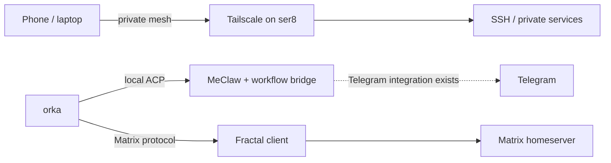

# MeClaw, Tailscale, and Matrix

## Structure

The Guix host is the Tailscale node. Tailscale provides private reachability
between ser8 and trusted devices; access policy remains managed in the
Tailscale admin console. MeClaw continues to run as a Guix Home Shepherd
service, with its existing local ACP workflow and Telegram integration.
Fractal is the desktop Matrix client and connects to the user's chosen
homeserver.

This installation does not deploy a Matrix homeserver and does not connect
MeClaw to Matrix. If Matrix is to become a MeClaw channel, add and maintain a
separate Matrix adapter with explicit room/user allowlists and test it before
enabling it. Do not expose the MeClaw bridge directly to the tailnet; use the
existing authenticated local workflow and a narrowly scoped adapter.

## Guix-managed components

- `tailscale` and its root Shepherd daemon are provided by the configured
  `abbe` channel and enabled in the system configuration. State is stored at
  `/var/lib/tailscaled.state`.
- The system nftables rules drop unsolicited inbound traffic, allow SSH only
  via `tailscale0`, and allow UDP 41641 for direct Tailscale paths. They also
  allow basic ICMP and DHCP replies. Other LAN services, including KDE Connect,
  need an explicit firewall exception if you want to use them.
- `fractal` is added to the Guix Home package environment as the Matrix client.
- MeClaw's pinned package and Home service were already present.

## Bring-up

After system reconfiguration, authenticate the host once with
`sudo tailscale up`, then check `tailscale status`. Approve the host in the
Tailscale admin console and set its device name/tags and ACL or grants there.
After Home reconfiguration, launch `fractal` and sign in to the desired
homeserver. Keep SSH and any future Matrix/MeClaw access limited by tailnet
policy; do not open public router ports for this setup.

## Rollout order

1. Reconfigure the system and confirm the `tailscaled` Shepherd service is
   running. Inspect live rules with `sudo nft list ruleset`.
2. Authenticate ser8 to the tailnet and verify access from a trusted device.
3. Reconfigure Guix Home and sign in to Matrix with Fractal.
4. Only if needed, design a Matrix-to-MeClaw adapter separately, with explicit
   authorization rules, secrets handling, and a disable/rollback path.
