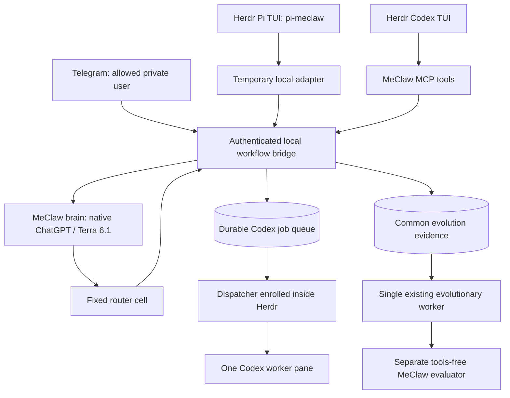

# MeClaw 로컬 통합

기본 coordinator를 MeClaw로 전환했다. ChatGPT 인증과 Terra 6.1을 사용하고, Herdr의
기본 대화 화면은 `pi-meclaw`다. [Pi 터미널 사용법](PI-MECLAW.md)을 따른다.
Codex MCP는 선택적 접근 경로이며 Codex 작업자는 단일 작업 큐로 연결한다. Telegram은 기존 봇·허용 사용자 설정을
읽는 고정 adapter가 직접 연결하며 Pi를 거치지 않는다. upstream Telegram connector와
전체 meclaw-os/Argus를 올린 구성은 아니다. 이 첫 단계에서는 기존 MetaSkill 중심의
진화 작업자와 `workflow-evolution` Git 보존 방식을 유지한다.

2026-10-31. MeClaw 0.76.6, Codex CLI 0.166.0, Terra 6.1, Herdr 0.8.2.

## Scope and milestones

M1 adopts a small MeClaw colony while preserving the existing evolution repository.
It connects ChatGPT authentication, a direct Pi TUI, optional Codex MCP, Telegram and
one enrolled Herdr Codex worker. M2 adds real project holdouts and task acceptance
checks; M3 evaluates Argus in observe-only mode before granting mutation targets.
The full meclaw-os, memory-hive, builder and autonomous topology changes are not
enabled in this first integration. Shared skills still use the existing bounded
Fast loop; meta-skill evolution remains a later milestone.

## Architecture



The native colony has four cells: brain, evaluator, router and terminal sink.
MeClaw edges own continuation of tool calls; the host adapter handles channel
history, allowlisted tools and the Herdr job register. No extra reasoning model
is needed for routing. Six tool calls per request, one active inference, one
Codex worker, four outstanding jobs. The original daily proposal budget and
explicit promotion/rollback rules remain.

대화 입력 문맥은 완전한 turn 경계에서 약 30개 메시지로 제한한다. 전체 장기 기억의
memory-hive 검색을 구현한 것은 아니다. 별도의 native trace DB는 private runtime이며
Git 백업 대상에 포함하지 않는다. Git으로 보존하는 진화 증거·스킬·평가 이력과 구분한다.

## Guix and persistent state

새 PC에서는 `workflow-evolution`을 먼저 clone하고 `codex login`을 완료해야 한다.
Telegram 자격증명과 허용 사용자 설정은 별도로 준비한다. Git에서 인증을 복원하지 않는다.
Telegram 없이 먼저 시작하려면 Home의 `telegram?`를 false로 선언한다.

`packages/meclaw.scm` installs the upstream static musl binary with a pinned
SHA256. `home-services/meclaw.scm` wires state, installs the Codex MCP entry and
starts the bridge plus its owned native process. No curl-to-shell installer runs.

```text
~/.local/share/meclaw-workflow -> ~/work/workflow-evolution/meclaw
  colony/                 native cell state and private traces; ignored
  runtime/host.db         private conversation history and job queue; ignored
  runtime/bridge-token    local authentication; ignored, mode 0600
  snapshots/observations.sql   reviewed observation ledger; tracked
```

Existing shared skills and evolution data stay in their original locations.
The evolution config selects `backend: meclaw`. Its model calls use the separate
evaluator, which receives the evaluation system prompt and has no tool schemas.
MicroClaw remains installed for rollback, but its gateway is disabled in Home so
only MeClaw polls the existing Telegram bot. Its credential configuration stays
private and is read by the Telegram adapter, not copied into Git or native cells.

Setup is idempotent: native seeds are written only when absent. Existing learned
state is preserved. Future seed migrations must be explicit. The Codex MCP block
is added without changing its global model or other existing settings; conflicting
entries fail rather than being overwritten. Restart a Codex session to load it.

## Herdr and Codex

For an interactive terminal, run `pi-meclaw` in your project directory. This talks
directly to MeClaw; no Codex frontend is required. [Pi usage](PI-MECLAW.md).

Native MeClaw uses `auth: oauth_subscription` and an explicit reference to the
existing `~/.codex/auth.json`. It does not copy the token into the repository.
The subscription version header is 0.166.0: the bundled default 0.147.0 rejected
Terra 6.1 during the live check. Codex and MeClaw share rotating authentication
state; if a concurrent refresh invalidates it, use `codex login` and retry after
checking the previous job outcome. Global Codex model settings are preserved.

The MCP server exposes `meclaw_chat`, `meclaw_status`, and `workflow_search`.
The native Codex TUI provides its normal tool approval UI. A worker role exposes
only status/search, so it cannot recursively ask the coordinator to delegate.

Herdr enrollment must run inside a genuine Herdr environment, not from Shepherd:

```sh
meclaw-workflow enroll
# Or explicitly enroll an existing Codex pane:
meclaw-workflow enroll --worker-pane <pane-id>
```

Enrollment reuses the named worker or creates one sibling pane without changing
focus, starts Codex, and launches one dispatcher with the real Herdr context.
After a Herdr server restart, enroll again. No server session IDs are hardcoded
in Guix. The dispatcher heartbeat tells the coordinator whether it is available.

Queued jobs are durable and deduplicated by run/tool ID. A dispatcher claims only
when the worker is idle. A blocked worker waits for the human in its Codex pane;
the dispatcher never selects an approval. Restart converts unfinished claimed
jobs to unknown and does not replay them. Inspect the pane/worktree first.
Completed means that the agent settled and returned output; acceptance tests and
diff verification still determine whether the requested task succeeded.

## Telegram

The bridge reads the existing default Telegram account and requires a nonempty
allowed-user list. Only a matching sender in their private chat is accepted;
groups and other senders do not invoke inference or enqueue work. This version
supports text and `/start`, `/job <id>`. It does not forward attachments or answer
Codex approval dialogs remotely. Channel histories and job visibility are scoped.

The adapter polls directly; Pi is not required. Both the MeClaw native daemon and
the bridge must remain running, while a Codex/Herdr UI can be closed independently.
Job delegation additionally requires a live enrolled worker. Poll offsets are
persisted before processing so a crash cannot silently repeat an action; a turn
interrupted at that boundary may need manual recovery. No automatic task retry.

## Security and operational boundaries

Native API: `127.0.0.1:10963`; authenticated bridge: `127.0.0.1:10964`.
The native API itself has no authentication: keep it on loopback. These are
same-user local tools, not an isolation boundary against another local process.
Bridge credentials and raw traces never enter observations or Git snapshots.

The host probe reports no Landlock and no delegated cgroup. Fixed router/sink
code explicitly uses `trust: trusted`; this is not an OS sandbox. No generated
code, arbitrary shell tool, builder mutation or autonomous policy changes are
enabled. Coding is delegated to the native Codex permission/sandbox path.

Inference timeout is bounded; a client timeout/cancellation is not proof a
previously queued Codex task stopped. Inspect its job ID before resubmitting.
The MCP implementation is synchronous and does not yet implement cooperative
per-request cancellation. Raw runtime DBs require a separate private backup if
full conversation/job recovery is needed; Git exports only evolution knowledge.

## Operation and rollback

```sh
cd ~/guix-system
make reconfigure-home NON_GUIX_UPDATES=0
herd status meclaw
meclaw-workflow status
meclaw-workflow ask --channel terminal --prompt '연결 상태를 설명해줘'
meclaw-workflow snapshot
workflow-evolution snapshot
```

For rollback, stop MeClaw before restarting the Telegram-capable MicroClaw gateway.
Remove the MeClaw Home service, set MicroClaw `gateway-enabled?` back to true,
select `backend: microclaw` in evolution config, and reconfigure. Keep both state
directories and Git history. Existing skills/archives are compatible with either
inference adapter. Stop an enrolled dispatcher when retiring its worker.

## Verification

Verification results and limitations are recorded in SESSION.md. A passing unit
suite is not evidence of improved coding accuracy. No autonomous skill promotion
or Argus tuning is enabled on the basis of this integration smoke test.

Sources: [MeClaw CLI](https://github.com/mmeyerlein/meclaw/tree/v0.76.6),
[cell contracts](https://github.com/mmeyerlein/meclaw/blob/v0.76.6/docs/cell-types.md),
[OpenAI authentication](https://learn.chatgpt.com/docs/auth).
