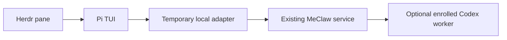

# MeClaw interactive terminal with Pi

Run this in a normal terminal or a Herdr shell pane:

```sh
cd ~/work/your-project
pi-meclaw
```

This is the direct interactive frontend: Pi displays the conversation, while the
existing MeClaw service owns inference, tools, memory context and job delegation.
It does not run a Codex model in front of MeClaw. Codex MCP remains an optional
separate way to call MeClaw from an existing Codex conversation.



## Commands

```sh
# Default conversation for this project
pi-meclaw

# Separate conversation for a particular task
pi-meclaw --session issue-123

# A single request through the same Pi frontend, without the interactive screen
pi-meclaw --session smoke --prompt 'Reply exactly READY'

# Check/start the background service if needed
meclaw-workflow status
herd start meclaw
```

Enter requests in Pi's input box. `/exit` closes the frontend. A backend channel
is derived from the canonical project path and `--session`; use the same pair to
continue its context after restarting Pi. Pi's `/new` resets its own display
session; choose a different `--session` to start a new MeClaw conversation.
The current project path is supplied as context on each request. It does not
expand the backend's allowed project roots or tool permissions.
The Pi model name is a transport identifier; actual model selection stays in
MeClaw. Pi's model picker does not change the backend model.

Inside Herdr you may name the running Pi agent and submit prompts normally:

```sh
herdr agent rename <pane-id> meclaw-ui
herdr agent prompt meclaw-ui 'Explain the available workflow tools.' --wait --timeout 300000
```

To enable coding delegation, run `meclaw-workflow enroll` inside Herdr. The
coordinator queues tasks to that single Codex worker. Its approval UI stays in
the Codex pane; Pi does not automatically approve or forward those dialogs.
If the worker pane was closed, enroll again. Unknown/closed workers are reported
unavailable instead of accepting new jobs into an unusable connection.

## What is installed

Guix Home runs `pi-meclaw setup` during activation. It prepares an isolated
`~/.local/state/pi-meclaw/agent` profile and uses the existing Guix-compatible Pi
executable helper. The normal Pi profile, OAuth files and MicroClaw profile are
preserved. The shared implementation helper retains its historical filename
`pi-microclaw`; MeClaw requests never invoke the MicroClaw backend.

The launcher opens `127.0.0.1:10965` only while it is running. A fresh bearer key
goes in a private temporary Pi profile, never in argv or Git. The backend request
is private JSON on stdin to `meclaw-workflow ask`. Pi tools, local skills and
prompt templates are disabled so MeClaw owns the execution context. Only the
latest user message is forwarded, with no duplicate frontend conversation.

Herdr sees a real Pi foreground executable and receives working/idle reports
from `custom:pi-meclaw`. The adapter performs no inference and adds no second
model call. Backend token usage is displayed when MeClaw reports it.

## Current limits

- Text only, one Pi–MeClaw launcher per PC. Image and frontend tool requests fail
  explicitly. Telegram continues to connect directly without Pi.
- Pi shows a processing indicator and the final response. This version does not
  stream individual model tokens or the native MeClaw tool trace.
- Escape, timeout or frontend exit stops waiting and its owned client process;
  an already accepted native run or queued Codex job may continue. Inspect the
  job before resubmitting. There is no cross-process exactly-once guarantee.
- MeClaw context is bounded; full memory-hive retrieval is a later milestone.
  Frontend history and private chats are not added to the evolution Git export.

For Telegram, evolution snapshots, installation and rollback, see
[MECLAW.md](MECLAW.md). For the retained MicroClaw frontend, see
[PI-MICROCLAW.md](PI-MICROCLAW.md).
