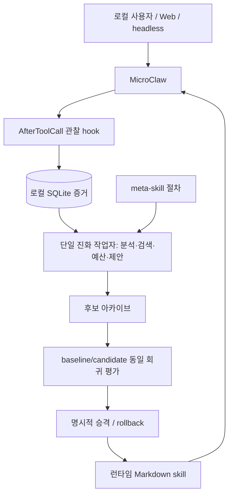

# MicroClaw 자기개선 워크플로

2026-10-31 후속: 기본 coordinator를 작은 MeClaw colony로 전환했다.
아래 문서는 최초 MicroClaw M1의 설계 기록이다. 기존 진화 저장소·후보 선택 규칙은
유지하며 현재 배포·Codex/Herdr·Telegram·복원 범위는 [MECLAW.md](MECLAW.md)를 따른다.

작성: 2026-10-31. 구현 기준: MicroClaw v0.11.1
(`11d355b5ab7a85fb18195e89087939dd76175fa9`).

## 최종 목표

2–3대 PC, 10개 이하 프로젝트에서 실행 증거를 축적하고, 검증된 절차를
재사용하며, 개선 방법 자체도 천천히 개선하는 개인용 생태계를 만든다.
성공률·회귀·지연·모델 호출 수를 함께 측정한다. 모델 가중치 학습은 범위 밖이다.

## 개념과 근거

[MetaSkill-Evolve](https://arxiv.org/abs/2607.05297)의 중심은 task skill s와
meta-skill m=(분석 ψ, 검색 σ, 예산 α, 제안 π, 선택 ε)의 두 시간척도다.
다섯 역할을 다섯 상주 프로세스로 구현할 필요는 없다. 한 작업자가 순서대로 수행한다.
Fast는 작업 스킬 후보, Slow는 개선 절차 후보를 생성한다. Slow도 검증이 필요하다.

[DarwinX/Beagle](https://github.com/SalesforceAIResearch/Beagle)에서는 증거 기반
선택, 후보 아카이브, 회귀 방지를 차용한다. 대규모 개체군/병렬 탐색은 도입하지 않는다.
champion 1개 + challenger 1개, 순차 평가, 실패 후보 보관으로 시작한다.

제시된 예시의 MetaClaw/SkillClaw 공동 개발 계보, 8.25배 효율, 70% 토큰 절약,
거의 0인 부하는 이 환경에서 검증된 사실이 아니다. 본 구현은 해당 제품의 통합이나
논문의 재현이 아니라 위 원리를 적용한 소규모 구현이다. 화면의 Blocked는 실패의
정답 라벨이 아니며 도구 오류도 작업 실패와 구분한다.

## 아키텍처

SQLite는 제어 상태·출처·평가 기록, Markdown은 모델에게 전달하는 절차다.
Vector/Graph DB는 Markdown의 대체재라기보다 필요한 지식을 찾는 인덱스다.
먼저 MicroClaw의 기존 structured memory/graph와 sqlite-vec 빌드 지원을 조사하고,
검색 실패율이 측정된 뒤 임베딩을 추가한다. 별도 중앙 DB 서버는 측정 후 결정한다.
SQLite 원본/WAL을 Git으로 동기화하지 않는다. 이후 승인된 스킬·meta-skill·익명화된
평가 fixture만 Git으로 동기화하고, 호스트별 로그와 자격증명은 로컬에 둔다.

MicroClaw 0.11.1은 data_dir/skills와 HOOK.md를 지원한다. 변경 파일의 무조건적인
즉시 반영을 가정하지 않고 새 요청/명시적 reload 또는 서비스 재시작 후 확인한다.
Guix 선언 파일은 시드이고, 진화 산출물은 쓰기 가능한 별도 로컬 상태다.
reconfigure 시 기존 상태를 덮어쓰지 않는다. SOUL은 자동 진화 대상이 아니다.

## 마일스톤과 완료 조건

| 단계 | 목표 | 완료 증거 / 다음 단계 조건 |
|---|---|---|
| M1 이번 세션 | MicroClaw 로컬 gateway, hook→SQLite, 단일 후보 생성, 회귀평가/승격/rollback, Guix Home 배포 | 단위·통합 검사, config check, 서비스 실행, 실모델 smoke; 실행 결과는 SESSION.md |
| M2 다음 반복 | 실제 프로젝트 1개(guix-system)의 검증 가능한 10개 이상 과제 | 고정 holdout, 3회 반복 평가, 오류/지연/호출 비교; 실제 성공 증거 없이 자동 승격 금지 |
| M3 | meta-skill Slow Loop 제안 및 평가 | Fast 평가 10건 이상 후 개선 절차 후보 1개; 별도 holdout에서 개선 증명; 정책/예산 상한은 고정 |
| M4 | 2–3대 PC의 승인 지식 Git 동기화 | 호스트 식별자, 충돌·오프라인·rollback 검사; 수동 push/pull부터 시작 |
| M5 | 측정에 따른 검색 확장 | top-k 품질/토큰/지연 비교 후 SQLite FTS/벡터/그래프 중 선택 |
| M6 | 제한적 자동 운영 | 충분한 실제 회귀 suite, 호출·시간·디스크 예산, 관측성 확보 후 자동 승격 검토 |

2026-10-31 연결 후속: Pi를 Herdr 지원 frontend로 사용하여 MicroClaw 도구 진행을
실시간 표시하고 native 승인 카드를 전달한다. 승인 대기는 실패 학습에서 제외한다.
세부 구현·live 검증 범위·다음 과제는 [PI-MICROCLAW.md](PI-MICROCLAW.md)에 기록한다.
이 연결 검증이 M2의 실제 프로젝트 평가 완료를 의미하지는 않는다.

M1은 일반 지능 향상 증명이 아닌 폐루프 기반 마련이다. 로컬 smoke의 점수가
좋아졌다고 실제 코딩 성능 향상으로 해석하지 않는다. 각 세션은 기록→후보 1개→평가
→채택/보류→다음 목표 갱신 순서로 반복한다. Herdr는 Claude/AGY 작업 위임 경로이고
화면 상태 자체는 진화 판정 근거가 아니다. 상세 검토는 [PROVIDERS-HERDR.md](PROVIDERS-HERDR.md),
실행 방법은 [RUNBOOK.md](RUNBOOK.md)를 따른다. Guix shell은 의존성 관리이고 보안 sandbox와 다르다.
